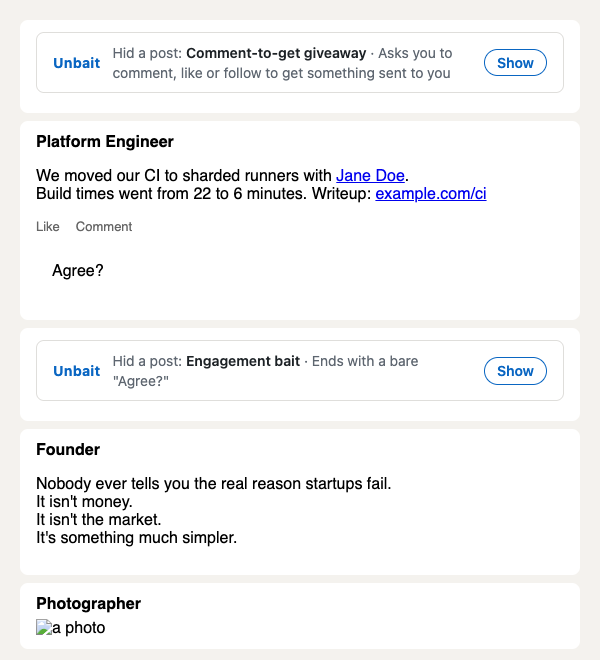
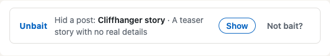
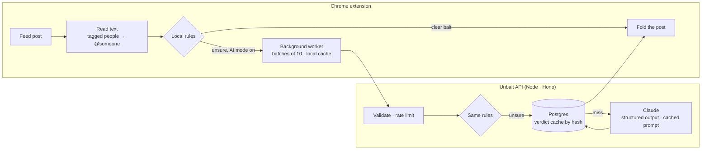

<p align="center"></p>

<h1 align="center">Unbait</h1>

<p align="center"><b>A browser extension that folds away engagement bait in your LinkedIn feed.</b><br/>
"Comment PDF and I'll send it", "Agree?", "I got rejected 47 times. Here's what happened 👇", "7 AI tools that will replace your team".<br/>
Each one becomes a single line you can open with one click.</p>

<p align="center">
<a href="../../releases/latest">Download</a> ·
<a href="#how-it-works">How it works</a> ·
<a href="#privacy">Privacy</a> ·
<a href="#how-well-it-works">Eval results</a> ·
<a href="#run-it-yourself">Run it yourself</a>
</p>

<p align="center"></p>

## What it hides

| Category | Looks like | Why it's bait |
| --- | --- | --- |
| **Comment-to-get giveaway** | "I put my playbook in a PDF. Comment PLAYBOOK and I'll send it." | Trades a resource for comments to game the algorithm |
| **Engagement bait** | "Hard work beats talent. Agree?", "Tag someone who…", "Type YES if…" | Exists to collect reactions, says nothing |
| **Cliffhanger story** | "I got fired on a Monday. / No warning. / Here's what happened 👇" | Dramatic hook, one line per sentence, no real details |
| **Hype listicle** | "99% of developers don't know these 5 tools that will 10x you" | Big promises, little substance |

Each category can be switched off. Hidden posts are never deleted, just folded: **Show** opens one, and in AI mode **Not bait?** brings it back for good and tells the server it got one wrong.

<p align="center"></p>

## How it works

Two layers, cheapest first:



1. **Rules in the browser.** 24 pattern rules catch the unmistakable cases instantly, with no network. They are tuned for precision: on the held-out eval set they have never hidden a real post. In "Rules only" mode (the default) this is all that runs.
2. **AI for the rest.** In "Rules + AI" mode, posts the rules can't decide go to the server in batches of ten. The server runs the rules again (it never trusts the client), checks its cache, and asks Claude only about text it hasn't seen before, using [structured output](apps/server/src/classifier.ts) so every answer is a valid category with a short reason. Identical posts are classified once, for everyone.

Things that keep it cheap and safe to run:

- **The system prompt never changes,** so it's served from Claude's prompt cache on every call after the first.
- **A daily AI budget** (`UNBAIT_DAILY_AI_POSTS`) caps spending; past it the server quietly falls back to rules.
- **Failures show the post.** If the AI or the server is down, posts stay visible; Unbait never hides something it hasn't decided on.
- **Post text is untrusted.** The prompt tells the model never to follow instructions inside a post, and posts are sent as JSON strings with server-side ids, not the client's.
- **Rate limits** per install and per IP, request size limits, and CORS that only admits extension origins.

## Privacy

- **Rules only (default):** nothing leaves your browser.
- **Rules + AI:** uses the hosted server unless you set your own under **Server** in the popup. Only the text of posts the rules couldn't decide is sent, with tagged people replaced by "@someone". Author names, your profile and your messages are never read.
- **The server stores no post text**, only a SHA-256 hash with the verdict, plus counters. Logs contain counts and timings, never text.
- **Permissions:** `storage`, and access to `linkedin.com`. Nothing else, enforced by an [end-to-end test](apps/extension/e2e/extension.e2e.ts).

## How well it works

A hand-labelled set of [105 fictional posts](evals/dataset.jsonl) (15 per bait category, 45 real posts), 44 of them deliberately hard: real posts that look like bait (a hiring post, a sincere "Thoughts?" question, a story with real numbers) and bait that doesn't look like the stereotype. Odd-numbered posts were used while writing the rules; even-numbered posts are held out.

**Rules only, held-out half** ([full results](evals/RESULTS.md)):

| | Precision | Recall | Real posts wrongly hidden |
| --- | ---: | ---: | ---: |
| All posts | 100% | 36% | 0 of 22 |
| Hard cases | 100% | 13% | 0 of 12 |

The rules are deliberately conservative: they never hid a real post, and catch the obvious third of the bait for free. Everything else is the AI's job, and the eval runner measures that too:

```bash
ANTHROPIC_API_KEY=... pnpm eval --ai --split test --write
```

It prints precision, recall, the posts it got wrong and the cost per 1,000 posts, and adds the table to [evals/RESULTS.md](evals/RESULTS.md).

## Install

1. Download `unbait-extension.zip` from the [latest release](../../releases/latest) and unzip it. Release builds use the hosted server at [api-production-8377d0da.up.railway.app](https://api-production-8377d0da.up.railway.app) for Rules + AI mode.
2. Open `chrome://extensions`, switch on **Developer mode**, click **Load unpacked** and pick the unzipped folder.
3. Open LinkedIn. Bait posts fold away as you scroll; the Unbait button in the toolbar shows counts and settings.

Works in Chrome, Edge, Brave and other Chromium browsers (114+).

## Run it yourself

Needs Node 22 and pnpm.

```bash
pnpm install
pnpm test                     # unit and API tests (62)
pnpm e2e                      # loads the extension in Chromium against a copy of the feed (7 checks)
pnpm eval                     # rules eval, free
pnpm dev:server               # API on http://localhost:8787 (rules only until you add a key)
pnpm build:extension          # extension in apps/extension/dist, pointed at localhost
```

With Docker and Postgres:

```bash
ANTHROPIC_API_KEY=... docker compose up
```

To build the extension against a deployed server:

```bash
UNBAIT_API_URL=https://your-server.example.com pnpm --filter @unbait/extension build -- --zip
```

Server settings are in [.env.example](.env.example). The model defaults to `claude-opus-5-5`; set `UNBAIT_MODEL=claude-haiku-5-5` to trade some accuracy for a much lower cost (run the eval on both before choosing).

### API

| | |
| --- | --- |
| `POST /v1/classify` | `{ installId, posts: [{ id, text }] }` (up to 10) → `{ results: [{ id, hash, verdict, reason, source }], degraded }` |
| `POST /v1/report` | `{ installId, hash, shown, expected }`: "this verdict was wrong" |
| `GET /v1/stats` | Totals for the landing page |
| `GET /health` | `{ ok, ai, model }` |

## Project layout

```
packages/core       categories, text normalisation, rules, API types (shared by all three)
apps/extension      Manifest V3 extension: content script, background worker, popup
apps/server         Hono API, Claude classifier, Postgres and in-memory stores
evals               labelled dataset and eval runner
```

**Stack:** TypeScript everywhere · Chrome Manifest V3 · Hono on Node 22 · PostgreSQL · Anthropic SDK with structured outputs and prompt caching · Vitest, jsdom and Playwright · Docker · GitHub Actions.

## Limitations

- **LinkedIn changes its page often.** The selectors live in one place ([`extract.ts`](apps/extension/src/extract.ts)) and cover both the current and the older feed layout, but a redesign can break them until they're updated.
- **English only.** Rules match English phrasing; the AI handles other languages but they aren't in the eval set yet.
- **"Bait" is a judgement call.** The categories are defined narrowly and the AI is told that hiding a real post is worse than missing a bait one, but it will sometimes disagree with you. That's what Show and Not bait? are for.

## Disclaimer

Unbait is an independent project, not affiliated with or endorsed by LinkedIn. It only changes how posts are displayed in your own browser. Review LinkedIn's User Agreement before use.

## License

[MIT](LICENSE)
